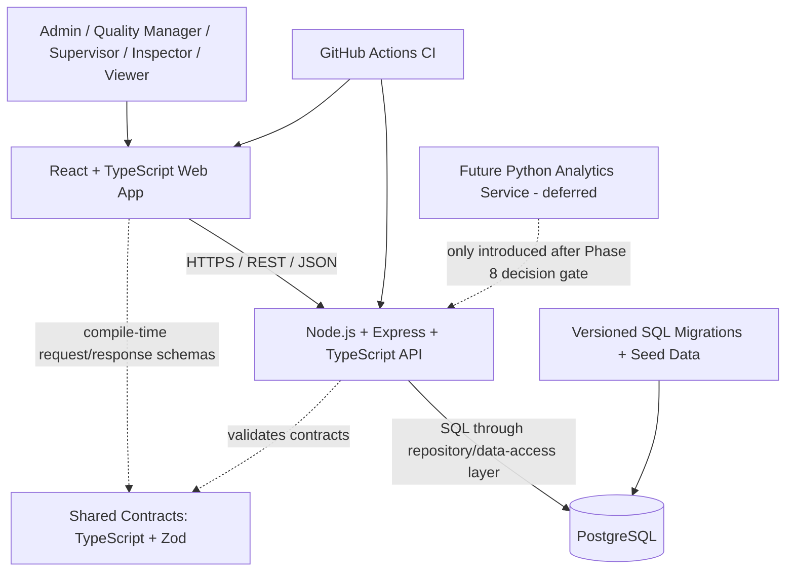

# QualityOps System Architecture

**Document status:** Proposed baseline  
**Version:** 1.0  
**Last reviewed:** 23 October 2026

## 1. Architectural goal

Build a maintainable, testable, security-conscious manufacturing quality platform that can grow without starting with unnecessary distributed-system complexity. Early releases should prioritize a working end-to-end quality workflow, reliable domain rules, and trustworthy metrics.

## 2. Chosen architecture

Use a **modular monolith for the business API**, with a separate web client and PostgreSQL database. Keep domain boundaries explicit inside the API. Start with one deployable API rather than several microservices. Advanced statistical processing may become a separate Python service later, after the core domain and metric definitions are validated.

## 3. Component responsibilities

### 3.1 Web app (`apps/web`)

- Render role-aware screens and navigation.
- Collect input and perform client-side usability validation.
- Call the API through one typed API client.
- Display loading, empty, success, and error states explicitly.
- Never connect directly to PostgreSQL or contain server secrets.
- Avoid embedding business rules only in the browser; the API is authoritative.

### 3.2 API (`apps/api`)

Organize by business modules, with clear layers:

- **routes/controllers:** HTTP parsing, status codes, request/response mapping.
- **application/services:** use cases and orchestration.
- **domain:** business rules and invariant checks.
- **repositories:** SQL/data access; no SQL scattered through controllers.
- **middleware:** request IDs, errors, authentication/authorization when implemented, rate limits, input validation.
- **config:** validated environment variables.

Phase 1 should only deliver a minimal health/readiness endpoint and architecture skeleton. Domain modules are built in later phases.

### 3.3 PostgreSQL (`database`)

- Store authoritative business records and relationships.
- Schema changes are delivered through reviewed, version-controlled SQL migrations.
- Development sample data is reproducible through seed scripts.
- Use foreign keys, uniqueness constraints, check constraints, and transactions where appropriate.
- Store timestamps consistently in UTC; present local time in the UI as a display concern.

### 3.4 Shared contracts (`packages/contracts`)

- Shared TypeScript/Zod schemas for API request/response shapes and common enums where appropriate.
- Keep domain rules in the API, not in the shared package.
- Avoid putting database models or server-only code in this package.

### 3.5 Future analytics service

Do **not** create a Python microservice just to make the architecture look advanced. Implement straightforward MVP aggregations with tested SQL/backend code first. During the analytics phase, evaluate whether control charts, statistical process control, anomaly analysis, or Python ecosystem libraries justify a FastAPI service. If introduced, the service must receive validated, purpose-limited inputs from the API and must not have uncontrolled direct write access to the operational database.

## 4. Technology baseline

- **Runtime:** Node.js 24 LTS for local and CI development; keep `.nvmrc` aligned.
- **Frontend:** React 19.x, TypeScript, Vite 8.x, React Router, a restrained component/styling system, and a charting library selected during the frontend phase.
- **API:** Express + TypeScript; Zod for environment/request validation; structured error handling; OpenAPI documentation.
- **Database:** PostgreSQL 18.x, using current supported minor/security releases.
- **Database access:** `pg` connection pool and explicit SQL repositories for the initial version, so analytical queries remain inspectable and portable. Use parameterized queries only.
- **Migrations:** a well-maintained SQL migration runner; select/pin a stable version during scaffold after a smoke test. Do not rely on ad hoc manual database edits.
- **Testing:** Vitest for TypeScript unit tests, Supertest for HTTP integration tests, and Playwright for selected end-to-end flows once screens exist.
- **Local infrastructure:** Docker Compose for PostgreSQL; application containers can be added after the local dev flow works.
- **CI:** GitHub Actions for install, lint, format check, type-check, test, and build.

**Version policy:** Use stable releases compatible with the selected Node.js LTS. Do not blindly install prereleases or use `latest` in a reproducible build. As checked on 23 October 2026, Node.js 24 is listed as LTS, React docs list 19.3 as latest, Vite's blog lists 8.1, and PostgreSQL 18 is the current major supported line. Recheck official release/support pages when scaffolding and pin exact dependency versions in lockfiles.

## 5. API design principles

- REST resource routes under `/api/v1`.
- JSON request and response bodies.
- Consistent error envelope including stable error code, readable message, optional field details, and request ID; never return stack traces to clients.
- Input validation at the API boundary.
- Pagination and filtering for list endpoints when introduced.
- ISO-8601 timestamps in API responses; UTC storage.
- API contract documented in OpenAPI and kept in sync with implementation.
- Use appropriate HTTP semantics (`GET`, `POST`, `PATCH`, `DELETE` only where permitted).
- Enforce authorization on the server for every protected operation.

## 6. Data integrity and analytics principles

- Separate **unit counts**, **inspection sample counts**, and **defect-occurrence counts**. Never mix these denominators.
- Decide whether a production unit can have multiple defect occurrences; the data model and KPI definitions must make this explicit.
- A batch is not automatically “good” merely because some inspection sample passed.
- Keep numerator and denominator definitions next to the KPI implementation and in `docs/requirements/kpi-dictionary.md` when created.
- Do not present synthetic demonstration data as real factory outcomes.
- Show data source, date range, denominator, and any caveat for a KPI where relevant.

## 7. Security boundaries

- Browser never connects directly to the database.
- Secrets are environment-injected and never committed.
- Server validates all inputs and enforces permissions.
- Passwords are hashed with an appropriate password-hashing algorithm when authentication is implemented.
- Token/session transport and CSRF strategy must be selected in the authentication phase after a threat-model review; do not improvise it in Phase 1.
- Sensitive changes should eventually create audit events.
- Use least-privilege database credentials; separate local developer credentials from production credentials.

## 8. Deployment model

### Development

- Web and API run locally using npm scripts.
- PostgreSQL runs using Docker Compose.
- Local `.env` file stays untracked.

### CI

- Install from lockfile.
- Run formatting check, lint, type-check, tests, and production builds.
- Add a PostgreSQL service for integration tests when those tests are introduced.

### Production (future phase)

- Deploy web and API to managed hosting/containers.
- Use managed PostgreSQL or a securely configured persistent database.
- Configure TLS, secrets, backups, monitoring, retention, migrations and rollback procedures before calling the system production-ready.

## 9. Known architecture risks and responses

| Risk                                         | Response                                                                                    |
| -------------------------------------------- | ------------------------------------------------------------------------------------------- |
| Overengineering with premature microservices | Begin with a modular monolith; separate analytics only at a documented decision gate.       |
| AI-generated code inconsistency              | Small tasks, explicit acceptance criteria, human review, lint/type/test gates.              |
| Metrics are mathematically misleading        | Approved KPI dictionary and denominator-focused test cases.                                 |
| Frontend contains authoritative rules        | Enforce all business rules in the API/domain layer and database constraints where possible. |
| Secret leakage                               | `.env.example` only; `.env` ignored; inspect diffs before commits.                          |
| Fake demo outcomes                           | Label synthetic data in UI, screenshots, README and reports.                                |

## 10. Official references checked 23 October 2026

- Node.js release/status: https://nodejs.org/en/about/previous-releases
- React versions: https://react.dev/versions
- Vite release blog: https://vite.dev/blog
- PostgreSQL supported versions: https://www.postgresql.org/support/versioning/
- Docker Compose: https://docs.docker.com/compose/
- Prisma release state (used as a caution against blindly choosing an ORM prerelease; this architecture chooses parameterized SQL initially): https://www.prisma.io/docs/orm
